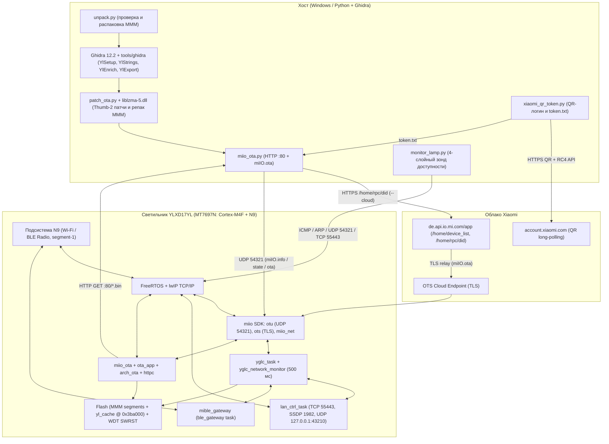
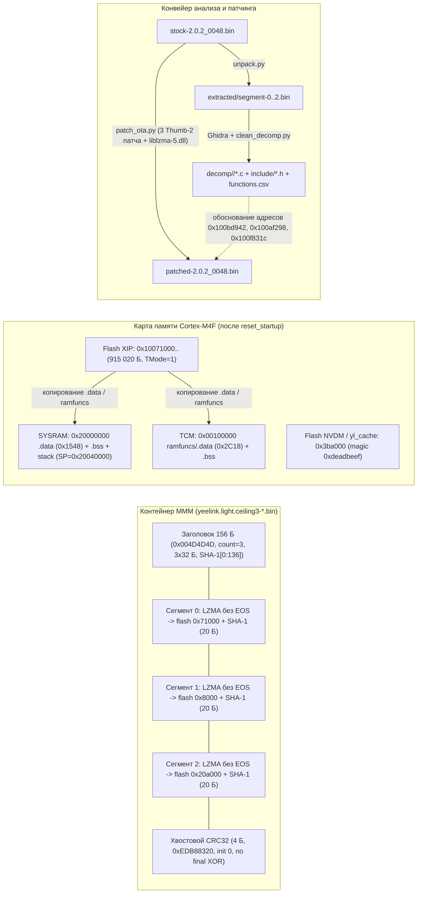
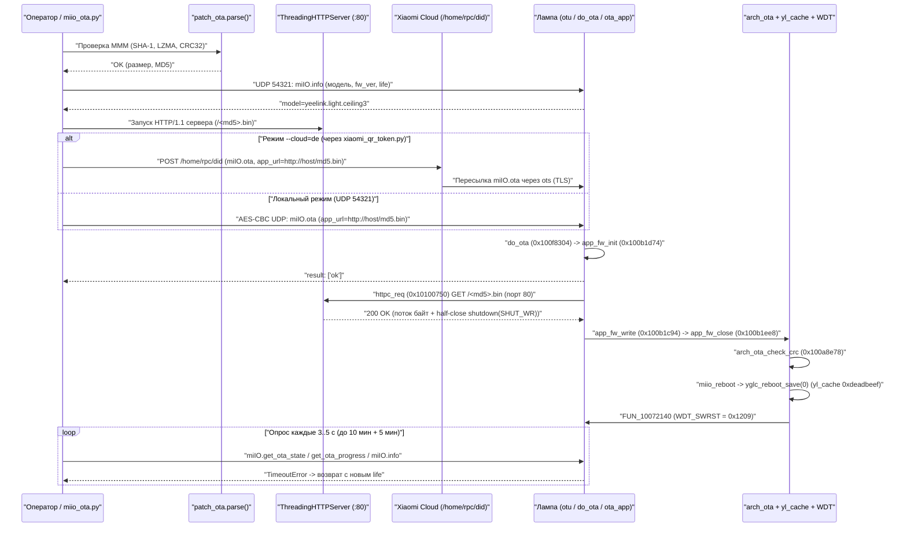
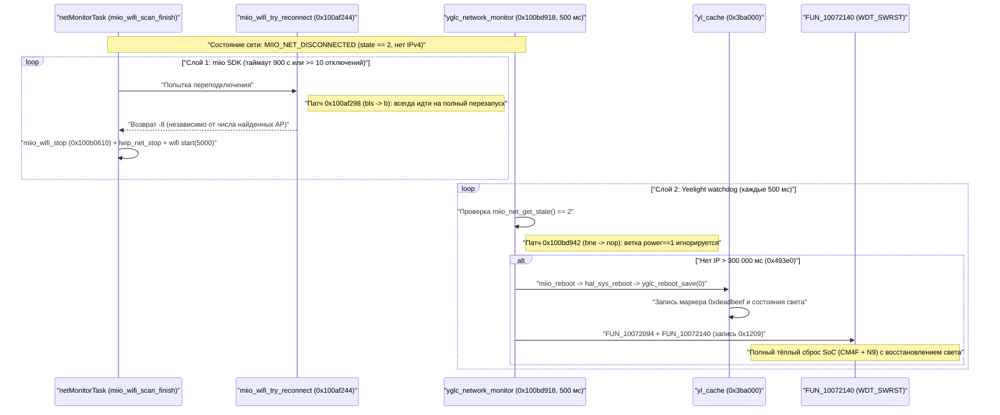

# Архитектурные диаграммы (Architecture Diagrams)

## 1. Общая архитектура системы и контуры взаимодействия

Система разделена на хостовый контур анализа/доставки (корень репозитория), внешний контур Xiaomi Cloud и встроенную систему на кристалле MediaTek MT7697N (`yeelink.light.ceiling3`).

## 2. Иерархия компонентов: контейнер `MMM`, карта памяти CM4F и конвейер сборки

Ниже показаны границы данных внутри OTA-контейнера `MMM`, отображение сегмента 0 в адресное пространство Cortex-M4F и поток преобразования бинарных артефактов.

## 3. Последовательность OTA-прошивки (`miio_ota.py flash`)

При использовании флага `--cloud=de` команда `miIO.ota` маршрутизируется через облачный RPC Xiaomi (`/home/rpc/<did>`), чтобы обойти проверку источника команды в `do_ota` (на стоке локальный вызов отклоняется с ошибкой `-30020`; при установленном патче `0x100f831c` проверка флага обходится). Саму загрузку образа лампа всегда выполняет по HTTP на порт `80` ПК, так как `httpc_req` (`0x10100750`) не извлекает `:port` из URL.

## 4. Двухуровневое восстановление Wi-Fi (с патчами)

В прошивке работают два независимых контура восстановления сети: SDK-уровень (`miio_net` в задаче `netMonitorTask`) и прикладной уровень (`yglc_network_monitor` по 500-миллисекундному таймеру). Патчи в `patch_ota.py` устраняют два блокирующих условия: пропуск перезапуска Wi-Fi/lwIP при `>= 2` AP и отмену тёплого авторебута при включённом свете.

## 5. Границы сервисов и коммуникационные паттерны

- **Граница ПК <-> Лампа в локальной сети**:
  - Управляющий обмен `miio` работает поверх **UDP `54321`** с шифрованием AES-128-CBC (ключ/IV выводятся из 16-байтового `token.txt` через MD5) и контролем целостности MD5.
  - Протокол Yeelight LAN Control работает по **TCP `55443`** (строковый JSON, разделённый `\r\n`) и **UDP multicast `239.255.255.250:1982`** (SSDP discovery/notify).
  - Передача OTA-образа выполняется по **HTTP/1.1 на TCP-порту `80`** (`miio_ota.py` -> `httpc_req`, поддерживаются `200 OK` и `206 Partial Content` по `Range`).
- **Внутрипроцессное взаимодействие в RTOS**:
  - Передача команд управления внутри `lan_ctrl_task` использует локальный loopback-сокет **`127.0.0.1:43210`** (`0xa8ca` в `lan_ctrl_init` @ `0x100c41e4`) и собственный цикл `select()` в `FUN_100bba24`.
  - Конвейер `ota_app` изолирует скачивание и запись во flash в отдельную задачу `ota_app` (`miio_ota_app_init` @ `0x100b203c`), а финальная перезагрузка откладывается на 4000 мс через таймер в `miio_reboot` (`0x100f81e4`) для отправки ответа/события `miio_reboot`.
- **Известный пробел границ**: если N9 или lwIP зависает с уже назначенным IP (`state == 3 LOCAL` или `4 CLOUD`), ни `netMonitorTask`, ни `yglc_network_monitor` не срабатывают, так как нет активного liveness-зонда трафика (ICMP/ARP/шлюз). На хосте этот режим детектируется как `ZOMBIE` скриптом [monitor_lamp.py](../../monitor_lamp.py).
