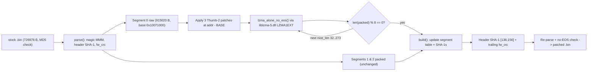
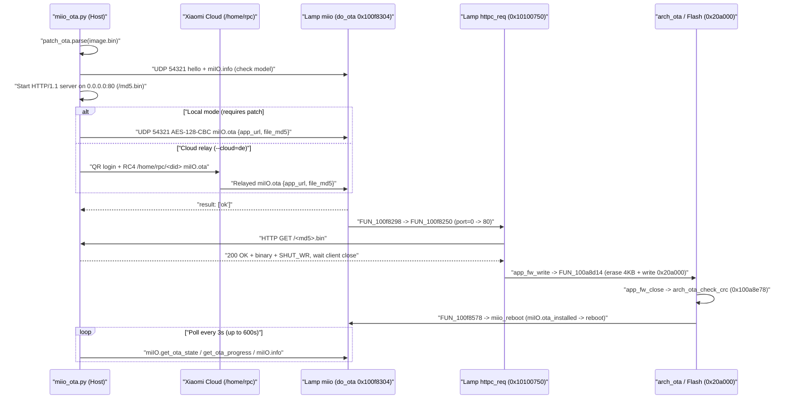
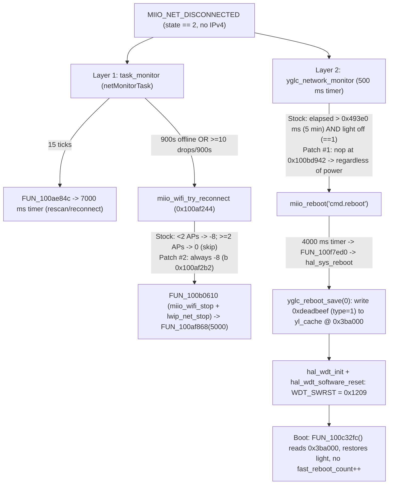

# Потоки данных (`data-flow.md`)

Документ описывает три ключевых потока данных в проекте анализа и патчинга прошивки потолочного светильника Yeelight `YLXD17YL` (`yeelink.light.ceiling3`, `2.0.2_0048`):
1. Сборка и верификация патченого OTA-образа в [patch_ota.py](../../patch_ota.py).
2. Доставка и установка OTA-образа через [miio_ota.py](../../miio_ota.py) и подсистему OTA прошивки.
3. Runtime-потоки восстановления Wi-Fi, тёплой перезагрузки, локального управления LAN и хостового мониторинга в [monitor_lamp.py](../../monitor_lamp.py).

---

## 1. Конвейер распаковки, патчинга и переупаковки OTA (`patch_ota.py`)

Исходный образ `yeelink.light.ceiling3-stock-2.0.2_0048.bin` (726 978 байт, MD5 `13b7471a0f84e3cfbac78c116fae7a1c`) упакован в контейнер `MMM` (`0x004d4d4d`) с тремя LZMA-сжатыми сегментами.

### Пошаговый поток обработки

1. **Входная валидация и разбор контейнера (`parse()`)**:
   - Проверяется MD5 стокового файла (`13b7471a0f84e3cfbac78c116fae7a1c`), заголовок `magic == 0x004d4d4d`, `count == 3` и `SHA-1(data[:136]) == data[136:156]`.
   - Проверяется завершающий 4-байтовый CRC32 (`fw_crc(data[:-4])`, таблица `0xEDB88320`, `init = 0`, без финального XOR — эквивалент `zlib.crc32(data, 0xffffffff) ^ 0xffffffff`, повторяющий прошивочный `arch_ota_check_crc` @ `0x100a8e78`).
   - Из 32-байтовых записей таблицы сегментов (начиная со смещения `8`, формат `<8I`) читаются `(off, addr, size, part, doff, dlen, comp, _res)`. Для каждого сегмента сверяются `off + size == doff`, `dlen == 20`, `comp == 1` и `SHA-1(packed) == data[doff:doff+20]`.
   - Каждый `packed` поток распаковывается `lzma.LZMADecompressor(format=lzma.FORMAT_ALONE)` с проверкой `dec.eof`, отсутствия `unused_data` и совпадения длины с `<Q` полем размера в 13-байтном заголовке LZMA (`packed[5:13]`).
   - Дополнительно проверяется детерминированность пересборки без патчей: `build(stock, parse(stock)[0][1]) == stock`.

2. **Бинарное патчирование сегмента 0 (`BASE = 0x10071000`)**:
   - Если не передан флаг `--stock`, в распакованный массив `raw` сегмента 0 по смещениям `addr - BASE` вносятся 3 патча (с предварительной `assert`-проверкой стоковых байт):
     - `0x100bd942` (`FUN_100bd918` / `yglc_network_monitor`): `efd1` (`bne #0x100bd924`) → `00bf` (`nop`).
     - `0x100af298` (`miio_wifi_try_reconnect`): `0bd9` (`bls #0x100af2b2`) → `0be0` (`b #0x100af2b2`).
     - `0x100f831c` (`do_ota`): `13d4` (`bmi #0x100f8346`) → `13e0` (`b #0x100f8346`).

3. **Переупаковка без маркера конца потока (`lzma_alone_no_eos()`)**:
   - Стандартный модуль `lzma` в Python всегда добавляет EOPM-маркер, тогда как стоковый загрузчик использует потоки LZMA-alone с явно заданным размером и без маркера конца.
   - Через `ctypes` загружается `liblzma-5.dll` (требуется `lzma_version_number() >= 50040002`, т.е. `>= 5.4`).
   - Задаётся `LzmaOptions` на базе `lzma_lzma_preset(&opt, 0)` с параметрами стокового потока (`lc`, `lp`, `pb` из `packed0[0]`, `dict_size` из `packed0[1:5]`), `mode = 1` (`LZMA_MODE_FAST`), `mf = 0x04` (`LZMA_MF_HC4`), `depth = 0`, `ext_flags = 0` (запрет `LZMA_LZMA1EXT_ALLOW_EOPM`) и точным размером `ext_size_low`/`ext_size_high = len(raw)`.
   - В цикле перебирается `nice_len` от `32` до `273`; вызов `lzma_raw_buffer_encode` с фильтром `0x4000000000000002` (`LZMA_FILTER_LZMA1EXT`) останавливается на первом `nice_len`, для которого 13-байтный заголовок + сжатые данные имеют длину, кратную `8` (`len(packed) % 8 == 0`), что сохраняет 8-байтовое выравнивание сегментов 1 и 2.

4. **Пересчёт заголовка, подписей и финальная самопроверка (`build()` + `main()`)**:
   - В 136-байтном заголовке обновляются `off`, `size`, `doff` для всех сегментов (с проверкой `len(packed) <= ent[3]` — вписывания в размер раздела); сегменты 1 и 2 переносятся без перепаковки.
   - К `hdr` добавляется `SHA-1(hdr)` (байты `136..155`), далее тела сегментов с их `SHA-1(packed)` (по 20 байт), и в конец дописывается `struct.pack('<I', fw_crc(out))`.
   - Итоговый файл (`yeelink.light.ceiling3-patched-2.0.2_0048.bin` или `yeelink.light.ceiling3-repacked-stock-2.0.2_0048.bin` при `--stock`) повторно проходит `parse(out)` и проверку отсутствия EOPM (попытка распаковки с подменённым размером `-1` не должна завершаться `d.eof == True`).

---

## 2. Доставка OTA-обновления (`miio_ota.py` → прошивка)

Передача и установка образа объединяют транспорт `miio` (UDP `54321` или облачный RPC), локальный HTTP/1.1-сервер на порту `80` и загрузчик OTA внутри прошивки.

### Ключевые детали потока

1. **Идентификация и шифрование `miio` ([miio_ota.py](../../miio_ota.py))**:
   - Читается 32-символьный hex-токен из `token.txt`. Ключ и вектор инициализации для `AES-128-CBC` с PKCS7-дополнением вычисляются как `key = MD5(token)`, `iv = MD5(key + token)`.
   - Пакет `0x2131` (32-байтовый заголовок + зашифрованный JSON) подписывается полем `MD5(head + token + payload)` (байты `16..31`). Перед вызовом `miIO.ota` проверяется `miIO.info` (`model == 'yeelink.light.ceiling3'`, фиксируется начальный `life`).

2. **Выбор канала доставки `miIO.ota`**:
   - **Локальный вызов** (`dev.call('miIO.ota', params)` по UDP `54321`): в стоковой прошивке `do_ota` (`0x100f8304`, miio_ota.c) проверяет флаг `*(int *)(param_1 + 8) << 0x1e` (происхождение запроса). Без патча #3 (`0x100f831c`) локальный вызов отвергается (`ota is from local, droped`, возврат `-30020`).
   - **Облачный ретранслятор** (`--cloud=de` и др.): через [xiaomi_qr_token.py](../../xiaomi_qr_token.py) выполняется QR-авторизация (`login()`), поиск `did` в `/home/device_list` и отправка `miIO.ota` через `/home/rpc/<did>`. При этом `app_url` по-прежнему указывает на локальный ПК в LAN.

3. **HTTP-транспорт и ограничение порта `80`**:
   - В прошивке `FUN_100f8250` (miio_core.c) передаёт в `httpc_req` (`0x10100750`, httpc.c) структуру запроса с полем порта `param_2[2] == 0`.
   - `httpc_req` не парсит `:port` из URL-строки и при `sVar8 == 0` подставляет `0x50` (`80`) для `http://` (и `0x1bb` / `443` для `https://`), поэтому локальный `ThreadingHTTPServer` в `serve()` обязан слушать порт `80`.
   - После `self.wfile.write(data)` сервер делает `shutdown(socket.SHUT_WR)` и ждёт закрытия соединения со стороны лампы (`recv(4096)` с таймаутом `180` с), чтобы не зафиксировать ложное завершение передачи до фактического вычитывания буфера встраиваемым клиентом.

4. **Приём, запись во flash и проверка CRC в прошивке**:
   - `do_ota` парсит JSON `params` (`jsmi_parse_start`), вызывает `app_fw_init` (`0x100b1d74`, ota_app.c) и запускает HTTP-загрузку через `FUN_100f8298` → `FUN_100f8250` → `httpc_req`.
   - `arch_ota_select_flash` (`0x100b1d0c`, arch_ota.c) назначает staging-область flash с базы `0x20a000` (`DAT_100a8ca8`) длиной `0x130000` (1 245 184 байт; допустимый размер образа `0x2800..0x130000`).
   - По мере приёма чанков `app_fw_write` (`0x100b1c94`) вызывает `FUN_100a8d14` (arch_platform.c), которая постранично стирает сектора по `0x1000` (4 КБ) через `arch_flash_erase` и пишет через `arch_flash_write`.
   - По окончании загрузки `app_fw_close` (`0x100b1ee8`) при наличии поля `original_length` проверяет подпись (`miio_signature_verify`), затем вызывает `arch_ota_check_crc` (`0x100a8e78`, arch_ota.c), читающую образ кусками по `0x80` байт из staging-flash и сверяющую CRC32 с завершающими 4 байтами. После успеха `FUN_100a8e66` фиксирует установку, а `FUN_100f8578` вызывает `miio_reboot(..., "miIO.ota_installed")` для перезагрузки.

---

## 3. Потоки восстановления сети, управления и мониторинга

### 3.1. Двухуровневое восстановление Wi-Fi и тёплая перезагрузка

- **Уровень 1 — `task_monitor` (внутри `miio_wifi_scan_finish` @ `0x100b0a08`, miio_net.c)**:
  - Настройки задаются в `miio_net_init` (`0x100b0074`): общий таймаут офлайна `+0x170 = 900` с, порог частоты обрывов `+0x1a4 = 10` за 900 с.
  - Пока `miio_net_state == 2` (`DISCONNECTED`), `FUN_100ae84c` каждые 15 тиков взводит таймер на `7000` мс (повторный поиск/подключение). При срабатывании `sta_monitor_offline_timeout` (`900` с) или `sta_monitor_offline_countout` (`>= 10` обрывов в 10 бакетах) вызывается `miio_wifi_try_reconnect` (`0x100af244`).
  - В стоке при `uVar1 >= 2` подходящих AP в списке сканирования `miio_wifi_try_reconnect` возвращает `0` и обходит полную остановку стека. Патч #2 (`0x100af298`: `0bd9` `bls` → `0be0` `b`) всегда возвращает `-8`, вызывая `FUN_100b0610` (`miio_wifi_stop` + `FUN_100b05a4` / `lwip_net_stop`) и перезапуск `FUN_100af868(5000)`. Этот уровень перезапускает только Wi-Fi/lwIP, но не сбрасывает SoC и сопроцессор N9.

- **Уровень 2 — `yglc_network_monitor` (`0x100bd918`, yglc_core.c)**:
  - Зарегистрирован в `yglc_init_async` (`0x100bedb4`, yglc_core.c) с периодом `500` мс.
  - При `FUN_100afc14()` (`miio_net_get_state`) `!= 2` обновляет 64-битный таймштамп в `g_offline_since_ms` (`0x20008030`).
  - При `== 2` дольше `0x493e0` мс (`300 000` мс = 5 минут) в стоке проверяет состояние питания (`*(int *)(*(int *)g_yglc_settings_ptr + 0x54) == 1`); патч #1 (`0x100bd942`: `efd1` → `00bf` `nop`) убирает эту проверку, позволяя инициировать перезагрузку и при включённом свете.
  - Вызывает `miio_reboot(..., "cmd.reboot")` (`0x100f81e4`, miio_core.c), который через `4000` мс (`FUN_100f7ed0` → `hal_sys_reboot` @ `0x10071e98` → `yglc_reboot_save(0)` @ `0x100bed64`) записывает маркер `0xdeadbeef` (`type = 1`) в `yl_cache` (`0x3ba000`) и запускает программный сброс WDT (`0x1209` в `hal_wdt_software_reset` @ `0x10072140`). После перезагрузки `FUN_100c32fc` (yl_cache.c) считывает кэш, обнуляет заголовок маркера и восстанавливает свет без увеличения `fast_reboot_count`.

### 3.2. Поток локального управления LAN (`lan_ctrl_task` ↔ `127.0.0.1:43210` ↔ `yglc`)

- В `lan_ctrl_init` (`0x100c41e4`, lan_ctrl_cli.c) создаются I/O-мультиплексор (`FUN_100bb9a6`), loopback UDP-сокет приёма на `127.0.0.1:43210` (`0xa8ca`), клиентский UDP-сокет для отправки команд в тот же адрес и поток `lan_ctrl_task` (`FUN_100c3648` @ `0x100c3648`, lan_ctrl_cli.c, стек `0x1000`).
- `yglc` отправляет управляющие дейтаграммы на `127.0.0.1:43210`, которые обрабатывает `lan_open_mchannel` / `ctrl_sock_recv` (`0x100c3e84`, lan_ctrl_cli.c):
  - тип `0` (`lan_ctrl_start`): поднимает TCP-сервер на порту `55443` (`0xd893`, `server_sock_recv` @ `FUN_100c39ec`, до 4 клиентов, keepalive `idle=10`, `cnt=3`, `intvl=2`) и multicast-сокет SSDP `239.255.255.250:1982` (`0x7be`, `FUN_100c4ca4`);
  - тип `1` / `2` / `3`: остановка сервера или открытие/закрытие music-mode TCP-канала;
  - тип `4`: рассылка JSON-ответов/уведомлений в конкретный или во все открытые LAN-сокеты.
- Входящие строки `\r\n` на TCP `55443` читает `lan_clnt_recv` (`FUN_100c3ee0`), парсит `id`, `method`, `params` (`jsmi_parse_start`) и диспетчеризует через `call_method` (`FUN_100c3814`) в контроллер `yglc`.

### 3.3. Поток хостового мониторинга (`monitor_lamp.py`)

Каждые `INTERVAL` секунд (по умолчанию `30` с) `probe()` в [monitor_lamp.py](../../monitor_lamp.py) последовательно опрашивает все уровни стека:
1. `ping()` — 2 попытки `ping -n 1 -w 1500 <IP>` (успех при наличии `TTL=` в stdout).
2. `miio()` — UDP `54321` hello (`21310020` + `ff*28`), ожидание 32-байтного ответа с магией `0x2131`.
3. `lan()` — TCP `55443`, команда `{"id":1,"method":"get_prop","params":["power","bright"]}\r\n`, проверка поля `result`.
4. `arp()` — выполняется последним, чтобы Windows успела обновить таблицу соседей после `ping`: `netsh interface ipv4 show neighbors`, проверка статуса `Reachable`.

Функция `verdict(st)` сводит 4 булевых флага к состояниям `OK`, `OFFLINE: no association/IP (patch covers this)`, `ZOMBIE: answers ARP, IP stack silent...`, `ZOMBIE: pings, but miio and LAN tasks dead...` или `PARTIAL: ... down`. Изменения состояния и heartbeat (раз в 30 мин) пишутся в `monitor_lamp.log`.
